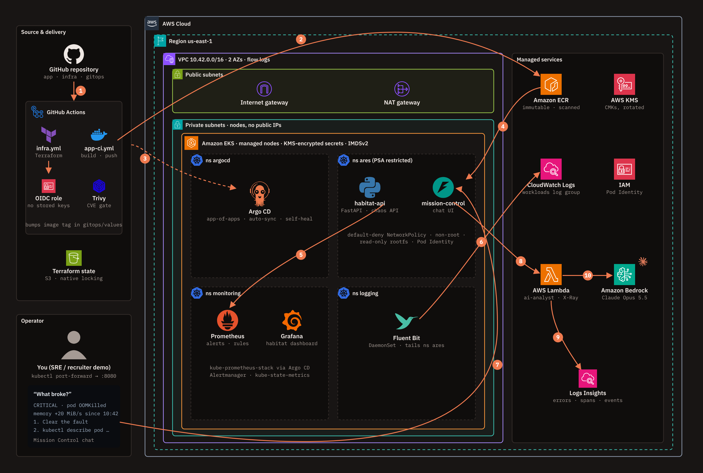

# ARES AIOps: Mission Control for a Mars Habitat

An end-to-end AIOps platform on AWS. A simulated Mars habitat (**ARES-1, Jezero Crater**) runs on Amazon EKS, Git is the single source of truth, Argo CD keeps the cluster in sync, Prometheus and Grafana watch it, Fluent Bit ships its logs to CloudWatch, and an **Ops Copilot built on Claude in Amazon Bedrock** tells you what is happening, why, and what to do next. You can break the habitat on purpose (dust storms, comms blackouts, an O₂ leak, memory leaks, a reactor SCRAM) and ask the copilot to explain it.



Interactive version of the diagram: [`docs/architecture.html`](docs/architecture.html).

| Layer | What it uses |
|---|---|
| Infrastructure | Terraform: VPC (2 AZs, private nodes, flow logs), EKS, ECR, KMS, IAM, Lambda |
| CI/CD | GitHub Actions with OIDC (no AWS keys), Trivy image scanning, Checkov IaC scanning |
| Delivery | Argo CD app-of-apps, Helm, automated sync with self-heal |
| Observability | kube-prometheus-stack (Prometheus, Alertmanager, Grafana), Fluent Bit to CloudWatch Logs, JSON logs with trace spans |
| AI | AWS Lambda + Claude Opus 5.5 on Amazon Bedrock, structured JSON diagnosis |
| UI | Mission Control: chat with the copilot, live signals, one-click chaos |

---

## Contents

1. [Repository layout](#repository-layout)
2. [What it costs](#what-it-costs)
3. [Prerequisites](#prerequisites)
4. [Step-by-step deployment](#step-by-step-deployment)
5. [Talk to it and break it](#talk-to-it-and-break-it)
6. [Verify everything works](#verify-everything-works)
7. [Troubleshooting](#troubleshooting)
8. [Teardown](#teardown)
9. [Security design and production hardening](#security-design-and-production-hardening)
10. [Showcasing the project](#showcasing-the-project)

---

## Repository layout

```
.
├── apps/
│   ├── habitat-api/          # FastAPI workload: telemetry, /metrics, JSON logs + spans, token-protected chaos API
│   └── mission-control/      # FastAPI chat console: snapshots K8s + Prometheus + Argo CD, invokes the AI Lambda
├── lambda/ai-analyst/        # Lambda: CloudWatch Logs Insights + Claude on Bedrock -> structured diagnosis
├── charts/ares-service/      # One hardened Helm chart used by both services
├── gitops/
│   ├── bootstrap/            # Argo CD Helm values, AppProject, root app-of-apps (applied once)
│   ├── apps/                 # Argo CD Applications: platform, kube-prometheus-stack, fluent-bit, the two services
│   ├── values/               # Per-app Helm values (CI writes image tags here)
│   └── platform/             # Namespaces (Pod Security), default-deny NetworkPolicy, alerts, Grafana dashboard
├── infra/
│   ├── bootstrap/            # One-time: Terraform state bucket + GitHub OIDC provider + 3 CI roles
│   └── terraform/            # VPC, EKS, ECR, KMS, IAM (Pod Identity), CloudWatch, Lambda
├── .github/workflows/
│   ├── infra.yml             # Terraform: plan on PR, apply on main (protected environment)
│   └── app-ci.yml            # test -> build -> Trivy -> push to ECR -> bump gitops tag
├── scripts/                  # configure, package-lambda, bootstrap-argocd, ui, load, teardown
├── local/                    # docker compose for running the apps on your laptop
└── docs/                     # architecture diagram (HTML + PNG)
```

---

## What it costs

Rough on-demand prices in us-east-1 while the stack is running:

| Item | Per day | Notes |
|---|---|---|
| EKS control plane | $2.40 | $0.10/hour |
| 2 × t3.large nodes | $4.00 | about $1.30/day with `node_capacity_type = "SPOT"` |
| NAT gateway + public IPv4 | $1.20 | plus $0.045/GB processed |
| EBS (2 × 40 GB gp3), KMS (2 keys), CloudWatch | about $0.50 | log ingestion is $0.50/GB; only the `ares` namespace is shipped |
| Claude on Bedrock | pay per question | each question sends roughly 10–20k tokens of telemetry; check [Bedrock pricing](https://aws.amazon.com/bedrock/pricing/) |
| **Total** | **about $8/day (about $5.50 with Spot)** | about $240/month if you forget it |

Build it, record your demo, and run [teardown](#teardown) the same day. Set an [AWS Budget](https://console.aws.amazon.com/billing/home#/budgets) alert at $20 before you start.

---

## Prerequisites

### Accounts

- An **AWS account** where you can use an admin-level IAM user or IAM Identity Center (SSO) role from your laptop.
- A **GitHub account**. A public repository is simplest (Argo CD can read it without credentials); private works too, see Step 8.

### Tools on your laptop

| Tool | Version | macOS (Homebrew) | Linux / Windows |
|---|---|---|---|
| AWS CLI | v2 | `brew install awscli` | [install guide](https://docs.aws.amazon.com/cli/latest/userguide/getting-started-install.html) |
| Terraform | ≥ 1.10 (tested with 1.16) | `brew tap hashicorp/tap && brew install hashicorp/tap/terraform` | [install guide](https://developer.hashicorp.com/terraform/install) |
| kubectl | within one minor version of the cluster | `brew install kubectl` | [install guide](https://kubernetes.io/docs/tasks/tools/) |
| Helm | 3.x | `brew install helm` | [install guide](https://helm.sh/docs/intro/install/) |
| GitHub CLI | any recent | `brew install gh` | [install guide](https://cli.github.com/) |
| Docker | Desktop or Engine | `brew install --cask docker` | [install guide](https://docs.docker.com/get-docker/) |
| Python | 3.12+ | `brew install python@3.12` | python.org |
| git, jq, openssl | any | preinstalled or `brew install jq` | package manager |

Windows users: run everything from **WSL2 (Ubuntu)**; the scripts are bash.

Check your toolchain:

```bash
aws --version && terraform version && kubectl version --client && helm version && gh --version && docker --version && python3 --version
```

---

## Step-by-step deployment

### Step 0 (optional): run it on your laptop first

No AWS needed. This proves the apps, metrics and chaos buttons work before you spend any money.

```bash
docker compose -f local/docker-compose.yml up --build
# habitat dashboard  http://localhost:8081
# Mission Control    http://localhost:8080   (chaos + live signals work; chat needs the AWS Lambda)
# Prometheus         http://localhost:9090
```

Run the unit tests too:

```bash
python3 -m venv .venv && source .venv/bin/activate
pip install -r apps/habitat-api/requirements-dev.txt -r apps/mission-control/requirements-dev.txt -r lambda/ai-analyst/requirements.txt
make test
```

### Step 1: put the code in your own GitHub repository

```bash
unzip ares-aiops.zip && cd ares-aiops   # or cd into this folder
git init -b main && git add . && git commit -m "ARES AIOps scaffold"
gh auth login
gh repo create ares-aiops --public --source . --push
```

Keep the name `ares-aiops` unless you also change `project` in Terraform and the names in `gitops/`.

### Step 2: configure the AWS CLI 

Pick one:

```bash
# IAM Identity Center (SSO), recommended
aws configure sso            # then: export AWS_PROFILE=<the profile name you chose>

# or an IAM user's access keys (only on your laptop, never in GitHub)
aws configure                # region: us-east-1, output: json
```

Confirm who you are, and note the ARN; you will need it for cluster access:

```bash
aws sts get-caller-identity
```

> If the ARN looks like `arn:aws:sts::123456789012:assumed-role/AWSReservedSSO_AdminAccess_abc123/you`, the value Terraform needs is the **role** ARN without its path: `arn:aws:iam::123456789012:role/AWSReservedSSO_AdminAccess_abc123`.

### Step 3: enable Claude on Amazon Bedrock

1. Open the [Bedrock console in us-east-1](https://us-east-1.console.aws.amazon.com/bedrock/home?region=us-east-1) and go to **Model catalog**.
2. Open **Claude Opus 5.5**. If it asks for Anthropic use-case details (a one-time form for first-time Anthropic users), submit it.
3. Smoke-test from your laptop:

```bash
pip install "anthropic[bedrock]"
python3 - <<'PY'
from anthropic import AnthropicBedrockMantle
c = AnthropicBedrockMantle(aws_region="us-east-1")
r = c.messages.create(model="anthropic.claude-opus-5-5", max_tokens=200,
                      output_config={"effort": "low"},
                      messages=[{"role": "user", "content": "Say hello to Mission Control in one line."}])
print(next(b.text for b in r.content if b.type == "text"))
PY
```

To use a different Claude model, set `bedrock_model_id` in `terraform.tfvars` (for example `anthropic.claude-sonnet-5-5` is cheaper).

### Step 4: bootstrap the Terraform state and GitHub OIDC roles (one time, from your laptop)

```bash
cd infra/bootstrap
cp terraform.tfvars.example terraform.tfvars      # set github_repository = "<you>/ares-aiops"
terraform init && terraform apply
terraform output -raw backend_config > ../terraform/backend.hcl
terraform output                                  # note the three role ARNs and the bucket
cd ../..
```

This creates:

- an encrypted, versioned, TLS-only **S3 bucket** for Terraform state (locking uses S3's native lock file, no DynamoDB);
- the **GitHub OIDC identity provider**, so workflows get short-lived AWS credentials;
- three roles, each trusted for exactly one context:
  - `ares-aiops-gha-terraform-plan`: read-only, for pull requests;
  - `ares-aiops-gha-terraform-apply`: only from the protected `aws-prod` GitHub environment;
  - `ares-aiops-gha-ecr-push`: push to `ares-aiops/*` ECR repositories, only from `main`.

### Step 5: configure the GitHub repository

```bash
REPO=<you>/ares-aiops
cd infra/bootstrap
gh secret set AWS_PLAN_ROLE_ARN  -R $REPO -b "$(terraform output -raw plan_role_arn)"
gh secret set AWS_APPLY_ROLE_ARN -R $REPO -b "$(terraform output -raw apply_role_arn)"
gh secret set AWS_ECR_ROLE_ARN   -R $REPO -b "$(terraform output -raw ecr_push_role_arn)"
gh variable set TF_STATE_BUCKET  -R $REPO -b "$(terraform output -raw state_bucket)"
cd ../..

gh variable set AWS_REGION                    -R $REPO -b "us-east-1"
gh variable set ADMIN_PRINCIPAL_ARN           -R $REPO -b "<your IAM user or role ARN from Step 2>"
gh variable set CLUSTER_ENDPOINT_PUBLIC_CIDRS -R $REPO -b "[\"$(curl -s https://checkip.amazonaws.com)/32\"]"
gh variable set NODE_CAPACITY_TYPE            -R $REPO -b "SPOT"
```

Then create the protected environment: **GitHub → Settings → Environments → New environment → `aws-prod`**, add yourself under **Required reviewers**, and restrict deployment branches to `main`. Every `terraform apply` now waits for your approval.

Also allow the CI bot to push the image-tag commits: **Settings → Actions → General → Workflow permissions → Read and write permissions**.

### Step 6: fill in your account details and provision the infrastructure

```bash
./scripts/configure.sh "$(aws sts get-caller-identity --query Account --output text)" us-east-1 https://github.com/<you>/ares-aiops.git
./scripts/configure.sh "$(aws sts get-caller-identity --query Account --output text)" us-east-1 https://github.com/bharathnani708/ares-aiops
git add gitops && git commit -m "Configure account, region and repo" && git push
```

Trigger the infrastructure workflow (or push any change under `infra/terraform/`):

```bash
gh workflow run infra.yml -R <you>/ares-aiops
gh workflow run infra.yml -R bharathnani708/ares-aiops
gh run watch -R <you>/ares-aiops
```

Approve the `aws-prod` deployment when GitHub asks. The apply takes about 15–20 minutes (EKS is the slow part).

<details>
<summary>Prefer to apply from your laptop?</summary>

```bash
cp infra/terraform/terraform.tfvars.example infra/terraform/terraform.tfvars   # fill in your ARN and IP
./scripts/package-lambda.sh
terraform -chdir=infra/terraform init -backend-config=backend.hcl
terraform -chdir=infra/terraform apply
```
</details>

### Step 7: build and push the images

```bash
gh workflow run app-ci.yml -R <you>/ares-aiops
gh workflow run app-ci.yml -R bharathnani708/ares-aiops
gh run watch -R <you>/ares-aiops
git pull                      # fetch the "deploy: ... -> <sha>" commit CI made in gitops/values
```

From now on, every push to `apps/**` on `main` tests, scans, builds and pushes both images, then commits the new tag. Argo CD deploys it; CI never touches the cluster.

### Step 8: connect kubectl and hand the cluster to Argo CD

```bash
aws eks update-kubeconfig --region us-east-1 --name ares-aiops
kubectl get nodes                                  # 2 nodes, Ready

./scripts/bootstrap-argocd.sh
# private repo? first:  export GIT_USERNAME=<you> GIT_TOKEN=<fine-grained PAT with read-only Contents>
```

The script creates two random secrets that never touch Git (the chaos API token and the Grafana admin password), installs Argo CD with Helm, and applies the root app-of-apps. Argo CD then installs everything else from Git in waves: platform namespaces and policies, kube-prometheus-stack and Fluent Bit, then the two services.

Watch it converge (about 5 minutes):

```bash
kubectl -n argocd get applications -w
```

All six applications should reach `Synced` / `Healthy`.

### Step 9: open the UIs

```bash
./scripts/ui.sh              # leaves port-forwards running; Ctrl+C stops them
```

| UI | URL | Login |
|---|---|---|
| Mission Control (chat + chaos) | http://localhost:8080 | none |
| Habitat dashboard | http://localhost:8081 | none |
| Grafana (dashboard "ARES Habitat — Mission Overview") | http://localhost:3000 | `admin` / `kubectl -n monitoring get secret grafana-admin -o jsonpath='{.data.admin-password}' \| base64 -d` |
| Prometheus | http://localhost:9090 | none |
| Argo CD | https://localhost:8443 | `admin` / `kubectl -n argocd get secret argocd-initial-admin-secret -o jsonpath='{.data.password}' \| base64 -d` |

In a second terminal, generate traffic so there is something to observe:

```bash
./scripts/load.sh 5
```

---

## Talk to it and break it

Ask Mission Control **"What's the status of my application right now?"** first. You should get a green `HEALTHY` answer with evidence (request rate, error ratio, p95 latency, O₂ level).

Then press a chaos button, wait 1–2 minutes for metrics and logs to reflect it, and press **"What broke?"**.

| Button | What actually happens | What you should see | A good question to ask |
|---|---|---|---|
| 🌪 Dust storm | +1.5–3 s latency in the `power-grid` subsystem; solar output drops | p95 > 1 s, `HabitatHighLatency` alert, slow `subsystem.power-grid` spans in CloudWatch | "Why is the habitat slow?" |
| 📡 Comms blackout | ~40% of telemetry requests return 503 with `RelayTimeout` errors | error ratio ~40%, `HabitatHighErrorRate` alert | "Why are requests failing?" |
| 🫁 O₂ leak | the business metric `habitat_oxygen_percent` falls steadily | `HabitatOxygenLow`, then `HabitatOxygenCritical`; dashboard turns red | "Is the crew safe?" |
| 🧠 Memory leak | the pod allocates 20 MiB/s until it hits its 256 Mi limit | `OOMKilled`, restart, `HabitatOOMKilled` alert | "Why did habitat-api restart?" |
| 🔥 Thermal runaway | a CPU-burning loop | CPU at the 500m limit, throttling ratio high, latency up | "Why is CPU so high?" |
| ☢ Reactor SCRAM | the process exits | restart count +1, `REACTOR SCRAM` critical log | "What just happened to the reactor?" |
| ✅ Clear all faults | resets every scenario on the pod that receives it | metrics recover within a few minutes | "Has the habitat recovered?" |

Chaos state lives in each pod, and there are two replicas, so a fault affects the replica that received the click. Press a button twice to hit both, or scale to one replica for clearer demos.

### GitOps scenarios

**Self-healing drift.** Change the cluster by hand and watch Argo CD revert it:

```bash
kubectl -n ares scale deploy habitat-api --replicas=0
kubectl -n argocd get application habitat-api -w     # OutOfSync -> Synced, pods come back
```

Then ask Mission Control: "Is the deployment in sync with Git?"

**Bad deploy and rollback through Git.** Point the image at a tag that does not exist:

```bash
sed -i 's/^  tag: .*/  tag: "does-not-exist"/' gitops/values/habitat-api.yaml
git commit -am "break: bad image tag" && git push
```

New pods go to `ImagePullBackOff` (the old ReplicaSet keeps serving thanks to `maxUnavailable: 0`), Argo CD shows `Degraded`, and the copilot should spot the waiting reason. Roll back the GitOps way with `git revert HEAD && git push`.

---

## Verify everything works

```bash
# Infrastructure
kubectl get nodes -o wide
aws eks list-pod-identity-associations --cluster-name ares-aiops --output table

# GitOps
kubectl -n argocd get applications

# Workloads and security posture
kubectl -n ares get pods,svc,networkpolicy
kubectl get ns ares --show-labels                       # pod-security.kubernetes.io/enforce=restricted

# Metrics: Prometheus is scraping habitat-api
curl -s 'http://localhost:9090/api/v1/query?query=up{namespace="ares"}' | jq '.data.result[] | {pod: .metric.pod, up: .value[1]}'

# Logs: Fluent Bit is shipping to CloudWatch
aws logs tail /aws/eks/ares-aiops/workloads --since 5m --format short | head

# AI: call the analyst Lambda directly
aws lambda invoke --function-name ares-aiops-ai-analyst \
  --cli-binary-format raw-in-base64-out \
  --payload '{"question":"Summarise the last 15 minutes"}' /dev/stdout | jq .
```

---

## Troubleshooting

| Symptom | Likely cause and fix |
|---|---|
| `kubectl` says `You must be logged in` or `Unauthorized` | `ADMIN_PRINCIPAL_ARN` doesn't match who you are. Use the IAM user ARN or the SSO **role** ARN (Step 2 note), re-apply. |
| `kubectl` times out | Your public IP changed. Update `CLUSTER_ENDPOINT_PUBLIC_CIDRS` and re-run `infra.yml`. |
| Pods `ImagePullBackOff` right after bootstrap | Images aren't in ECR yet, or `gitops/values/*.yaml` still says `tag: "initial"`. Run Step 7, then `git pull`. |
| `kube-prometheus-stack` stuck `OutOfSync` | The CRDs are large; it uses `ServerSideApply=true`. Click **Sync** once in Argo CD if the first attempt timed out. |
| ServiceMonitor / PrometheusRule errors on first sync | Their CRDs arrive with kube-prometheus-stack. The apps retry automatically; give it a few minutes. |
| No logs in CloudWatch | `kubectl -n logging logs ds/fluent-bit-aws-for-fluent-bit`. An `AccessDenied` means the Pod Identity association isn't matched: the service account must be `logging/fluent-bit`. |
| Chart values for Fluent Bit or kube-prometheus-stack rejected | Chart versions move. Run `helm show values eks/aws-for-fluent-bit` (or the prometheus-community chart) and adjust `gitops/values/*.yaml`, then pin an exact `targetRevision`. |
| Chat says `AI analyst unavailable` | Check `aws logs tail /aws/lambda/ares-aiops-ai-analyst --since 10m`. `AccessDenied` from Bedrock means model access isn't enabled (Step 3) or the IAM action list needs adjusting in `infra/terraform/lambda.tf`. |
| Lambda timeout | Lower `analyst_effort` to `low`, or raise `timeout` in `lambda.tf`. |
| `terraform apply` fails on Lambda `reserved_concurrent_executions` | New accounts have a low concurrency quota. Keep `lambda_reserved_concurrency = -1`. |
| EKS version not supported | Set `kubernetes_version` to one in standard support: `aws eks describe-cluster-versions --query 'clusterVersions[?status==\`STANDARD_SUPPORT\`].clusterVersion'`. |

---

## Teardown

```bash
./scripts/teardown.sh
```

It deletes the Argo CD applications first (so Kubernetes cleans up anything it created), uninstalls Argo CD, then runs `terraform destroy` on the main stack. The bootstrap stack (state bucket and OIDC roles) costs close to nothing and is kept; remove it with `terraform -chdir=infra/bootstrap destroy` after emptying the bucket.

Check nothing is left: `aws eks list-clusters`, `aws ec2 describe-nat-gateways --filter Name=state,Values=available`, and the Billing console the next day.

---

## Security design and production hardening

What is already in place:

- **No long-lived credentials.** GitHub OIDC for CI; EKS Pod Identity for Fluent Bit and Mission Control; node IMDS locked to hop limit 1 so pods cannot borrow the node role.
- **Least privilege everywhere.** Read-only PR plans; apply only through a protected environment; ECR push scoped to two repositories; Fluent Bit can write one log group; Mission Control can invoke one Lambda; the Lambda can query one log group.
- **Pull-based delivery.** CI has no cluster credentials. Argo CD pulls from Git, and its AppProject limits which repositories and namespaces it may use.
- **Cluster hardening.** Private nodes, API endpoint restricted to your IP, access entries (no `aws-auth`), control-plane audit logs, KMS envelope encryption for secrets, encrypted gp3 volumes, `upgrade_policy = STANDARD` to avoid extended-support charges.
- **Workload hardening.** Pod Security `restricted`, non-root UID 10001, read-only root filesystem, all capabilities dropped, seccomp `RuntimeDefault`, default-deny ingress NetworkPolicies enforced by the VPC CNI, PodDisruptionBudgets.
- **Supply chain.** Immutable ECR tags, scan on push, Trivy gate on critical CVEs in CI, Checkov on Terraform.
- **Data protection.** Customer-managed KMS keys (rotated) for logs and images, TLS-only state bucket, VPC flow logs for rejected traffic.
- **Fail-closed chaos.** The chaos API is disabled unless a random token (created at bootstrap, never in Git) matches, compared in constant time.

Next steps for production:

- Replace `AdministratorAccess` on the apply role with a scoped policy and a permissions boundary.
- Use External Secrets Operator with AWS Secrets Manager instead of bootstrap-created secrets.
- Expose Mission Control and Grafana through an internal ALB with Cognito or IAM Identity Center auth instead of port-forward.
- Add OpenTelemetry instrumentation with AWS X-Ray or Tempo for full distributed traces (today's traces are spans in structured logs).
- One NAT gateway per AZ, interface VPC endpoints (ECR, STS, Logs) to keep traffic private, Karpenter for node autoscaling.
- Sign images with cosign and enforce signatures with Kyverno or OPA Gatekeeper.
- Send Alertmanager notifications to Slack, and trigger the analyst automatically when an alert fires.

---

## Showcasing the project

A two-minute screen recording tells the story well:

1. The architecture diagram (`docs/architecture.html`).
2. A `git push` that changes the habitat dashboard, the GitHub Actions run, and Argo CD rolling it out.
3. Grafana and Mission Control both green; ask "What's the status?".
4. Press **🧠 Memory leak**, watch the pod get OOMKilled in Grafana, then ask "What broke?" and show the root cause and next steps.
5. `kubectl scale --replicas=0` and Argo CD healing it.
6. The security section of this README.

Useful hashtags: #AIOps #AWS #EKS #GitOps #ArgoCD #Prometheus #Grafana #AmazonBedrock #Claude #DevSecOps #Terraform.
